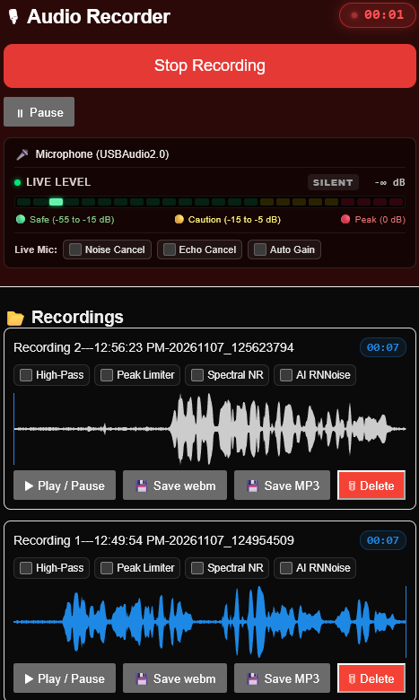

# 🎙 Audio Recorder




A browser-based studio audio recorder built with **Next.js**, **Web Audio API**, **WaveSurfer.js**, **RNNoise WebAssembly**, and **LAME MP3 Encoder**.

---

## ✨ Features

### 1. Live 24-Segment Sound Level (VU) Meter & Mic Check
- **Pre-Recording & Live Monitoring**: Works automatically before recording (`MIC CHECK`) and during recording (`LIVE LEVEL`).
- **Color-Coded Zones**:
  - 🟢 **Green (Safe)**: `-55 dB` to `-15 dB` (`GOOD`)
  - 🟡 **Yellow (Caution)**: `-15 dB` to `-5 dB` (`CAUTION`)
  - 🔴 **Red (Peak / Clip)**: `-5 dB` to `0 dB` (`PEAK / HIGH`) with peak-hold indicator
- **True Audible dB Readout**: Uses an `85 Hz` high-pass meter feed and 32-bit float time-domain analysis so silent rooms read `-∞ dB` (`SILENT`) without false sub-bass drift.
- **Active Microphone Display**: Shows the active input device name (automatically stripping USB/hardware hex IDs like `4c4a`) and updates when switching system microphones.

### 2. Live Microphone WebRTC Filters (Top Bar)
Toggle browser hardware/WebRTC constraints before recording:
- **Noise Cancel** (`noiseSuppression`)
- **Echo Cancel** (`echoCancellation`)
- **Auto Gain** (`autoGainControl`)

### 3. Non-Destructive Post-Recording Audio Remedies
Raw recordings are preserved untouched. Each recorded clip provides **4 independent checkboxes** that can be toggled individually or combined, immediately updating the **WaveSurfer** waveform and playback:
- **High-Pass**: `85 Hz` `BiquadFilterNode` that strips `11–12 Hz` USB sub-bass electrical rumble and low-frequency breath/plosive energy.
- **Peak Limiter**: `DynamicsCompressorNode` (`1 ms` attack) paired with a sample-accurate `±12 ms` lookahead envelope limiter to tame `1–3 ms` consonant spikes (`P`, `Bh`, `F`).
- **Spectral NR**: Audacity-style `1024`-bin FFT spectral subtraction noise reduction + `7.5 kHz` preamp hiss roll-off.
- **AI RNNoise**: Neural network voice isolation powered by `@shiguredo/rnnoise-wasm` (OBS / Discord-style AI noise suppression).

### 4. 48 kHz Export (WebM / WAV / MP3)
- **Save webm / Save WAV**: Downloads the raw `.webm` or the processed 16-bit PCM `.wav` when remedies are checked.
- **Save MP3 (`48 kHz`, `192 kbps`)**: Converts 100% client-side in the browser using `@breezystack/lamejs` at the full `48,000 Hz` sample rate (with an automatic server-side FFmpeg fallback route at `/api/convert-mp3`).

---

## 🚀 Getting Started

```bash
# Install dependencies
npm install

# Start development server
npm run dev

# Build for production
npm run build
npm start
```

Open [http://localhost:3000](http://localhost:3000) in your browser and allow microphone access.
